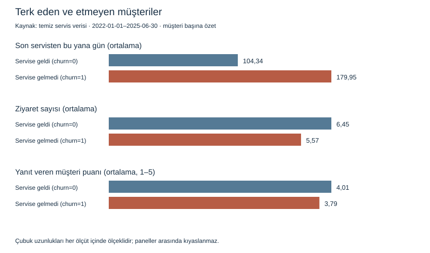
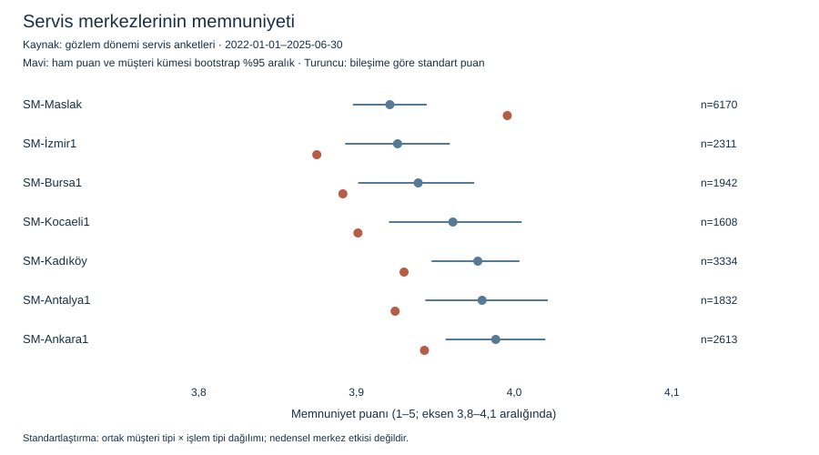

# Müşteri terk vakası — teslim raporu

Analiz, insan değerlendirmesi ve bonus sonuçları. Çalıştırma: [README](README.md).

## 1. Veri hazırlığı ve keşif

Gözlem penceresi **2022-01-01–2025-06-30**, hedef penceresi **2025-07-01–2026-06-30**; uç tarihler dahildir. Popülasyonda vakadaki “2025-06-30'dan önce” ifadesi sıkı `< 2025-06-30` yorumlandı: yalnız kesim günü ilk ziyareti olan bir müşteri dışarıdadır. Mevcut müşterilerin o günkü işlemleri özelliklere dahildir. Hedefte en az bir ziyaret varsa `churn=0`, yoksa `churn=1`: **3.315 gelen, 658 gelmeyen (%16,6)**. Servise gelmemek, başka servise geçtiğini kanıtlamaz.

Kaynakta **4.200 farklı müşteri**, son analizde **3.973 tekil müşteri satırı** vardır. Araçlar üzerinden servis ve geri bildirimleri doğrudan birleştirmek, ham servis satırlarını 32.770'ten 33.066'ya çıkarır. Bu nedenle tablolar ayrı özetlenip müşteri seviyesinde birleştirildi; tekillik kontrol edildi. Dört tarih biçimi ayrıştırıldı; geçersiz tarih/yetim ilişki bulunmadı. [Kontrol dökümü](ciktilar/veri_kalite.json).

**Üç veri kalitesi kararı:**

1. **Bulgu:** müşteri kartlarında 35, serviste 310 tam tekrar. **İşlem:** birebir tekrarları kaldırdım. **Gerekçe:** tekrarlar yeni ziyaret değildir; farklı içerikli satırlar korunmalıdır.
2. **Bulgu:** 150 negatif tutar ve 40 negatif kilometre. **İşlem:** ilgili değerler eksik bırakıldı, ziyaret korundu. **Gerekçe:** işlem kodu olmadan iade ile hatayı ayıramayız; değeri pozitif yapmak veri uydurur. Yüksek pozitif faturalar harcama toplamında korundu; modelde yalnız eğitimden öğrenilen %1–%99 sınırları uygulandı. Bu karar büyük filo faturalarını bastırabilir.
3. **Bulgu:** 74 geri bildirim satın alma tarihinden önce. **İşlem:** tarihsel özelliklerden ve aksiyon adaylarından çıkarıldı, ham LLM örnekleminde korundu. **Gerekçe:** sahiplik geçmişi olmadan o tarihte müşteriye aidiyet doğrulanamaz.

Recency son ziyaretten geçen gün, frequency ziyaret sayısı, monetary geçerli fatura toplamıdır. Tamamı eksik tutar sıfır sayılmaz. [Müşteri tablosu](ciktilar/musteri_analiz.csv).

**Üç keşif bulgusu** — “gelen”, hedef döneminde servisi ziyaret edendir:

- **Son ziyaretten geçen süre:** gelenlerde 104,34, gelmeyenlerde 179,95. Daha uzun ara, yeniden ziyaretin azalmasıyla birlikte görülüyor.
- **Ziyaret sıklığı:** gelenlerde 6,45, gelmeyenlerde 5,57. Daha sık geçmiş ziyaret, ilişkinin sürmesiyle birlikte görülüyor.
- **Memnuniyet:** gelenlerde 4,01, gelmeyenlerde 3,79. Daha düşük deneyim puanı terk grubuyla ilişkili; yalnız yanıt veren müşterileri temsil ediyor.

Bunlar ilişki bulgularıdır. [Ayrıntılı özetler](ciktilar/churn_bulgular.csv).

**Merkezler:** %21,0 anket yanıtsızlığı var; eksik puanlar doldurulmadı. [Merkez tablosu](ciktilar/merkez_karsilastirma.csv) işlem/müşteri/yanıt sayılarını, yanıt oranını ve 500 müşteri kümesi bootstrap tekrarından %95 aralıkları içerir. Aynı kişinin ziyaretleri bağımsız sayılmaz; aralıkların örtüşmesi resmi fark testi değildir.

Maslak'ın arıza onarım payı %34,3; diğerlerinde yaklaşık %14–15'tir. Ortak müşteri tipi × işlem tipi dağılımıyla puanı 3,920'den 3,995'e değişir. Düzeltilmiş puanlarda İzmir1 3,874 ile en düşük, Maslak en yüksektir; bu sıralama nedensel merkez etkisi değildir. [Bileşim dökümü](ciktilar/merkez_bilesim.csv) hücre örneklemlerini gösterir. Güncel müşteri tipiyle standardizasyon betimseldir; düzeltilmiş puanın belirsizlik aralığı hesaplanmadı.

**İş birimine yanıt:** “Merkezlerin puanlarında küçük farklar var, ancak hizmet verdikleri işler aynı zorlukta değil. Maslak daha çok arıza onarımı yapıyor; benzer müşteri ve işlem dağılımıyla karşılaştırınca kötü merkez olduğu sonucu desteklenmiyor. Anketi yanıtlamayanların görüşünü bilmiyoruz ve puanlarda belirsizlik var. Yönetim veya iş hacmi kararı öncesinde aynı tür işlerdeki şikâyetleri inceleyip yanıtsız müşterilerden de görüş toplayalım.”

## 2. Model, değerlendirme ve sınırlar

**Baseline**, eğitim sınıf oranını veren modeldir; **asıl model**, hızlı ve yorumlanabilir L2 düzenlemeli lojistik regresyondur. Müşteriler tabakalı ve sabit tohumla %60 eğitim / %20 doğrulama / %20 test ayrıldı: 2.383 / 795 / 795 kişi. Tabakalama azınlık temsilini, müşteri bazında ayrım bölüm tekilliğini korur. Doğrulama eşik seçimine, test son ölçüme ayrıldı. Sınırlandırma, medyanla eksik doldurma, eksik göstergeleri ve ölçekleme yalnız eğitimde öğrenildi. Bu ayrım benzer müşterileri değerlendirir; gelecek yıl başarısını kanıtlamaz.

**Sızıntı kontrolü:** güncel `crm_musteri_durumu`, tarihsiz `son_iletisim_notu`, kimlik ve tarihsel sürümü bilinmeyen demografi modele alınmadı. Servis/geri bildirimler gözlemle, araçlar kesime kadar satın alınmış olanlarla sınırlandı; hedef işlemleri yalnız hedef değişkenine girdi. LLM etiketleri churn modelinde kullanılmadı. Garanti satın almada, anket puanı servis döneminde biliniyor varsayıldı. Anket kayıt zamanı bulunmadığından üretimde doğrulanmalıdır.

**Metrik gerekçesi:** ROC-AUC eşikten bağımsız sıralamayı, average precision azınlık terk sınıfındaki kesinlik–yakalama dengesini ölçer. Precision@%20 iletişim listesinin isabetini, recall@%20 bu kapasiteyle yakalanan terk oranını gösterir. Accuracy tek başına yanıltıcıdır: baseline **%83,4 doğrulukla sıfır terk yakalar**; modelin %80,6 doğruluğu daha düşük olsa da terkleri ayırt eder.

Kapasite verilmediği için %20 varsayıldı. Doğrulamada seçilen **0,2633** eşik testte ayarlanmadı: iletişim oranı %18,1, precision %42,4, recall %46,2. En riskli 159 kişide precision **%40,9**, recall **%49,2**. Test ROC-AUC **0,753** (%95 aralık 0,709–0,798), average precision **0,454**; baseline karşılıkları **0,500 ve 0,166**. [Model sonuçları](ciktilar/model_sonuclari.json).

**En önemli beş değişken**, testte karıştırıldığında ortalama AUC düşüşüyle sıralandı:

- **Son ziyaretten geçen süre:** AUC düşüşü 0,151. İlişkinin soğumasını ve bakım aralığını yansıtabilir.
- **Ortalama memnuniyet:** AUC düşüşü 0,042. Hizmet deneyimiyle yeniden gelme isteği arasındaki ilişkiyi temsil edebilir.
- **Ortalama kilometre:** AUC düşüşü 0,029. Kullanım yoğunluğu ve bakım ihtiyacını temsil eder; sözlükteki ×1000 birimi kaynakla doğrulanmalıdır.
- **Ortalama araç yaşı:** AUC düşüşü 0,024. Garanti ve bakım ekonomisinin değişmesini yansıtabilir.
- **Ziyaret sıklığı:** AUC düşüşü 0,006. Geçmiş ilişkinin sürekliliğini gösterir; araç sayısıyla birlikte yorumlanmalıdır.

[Önem dökümünde](ciktilar/degisken_onemleri.csv) 10 tekrarın değişkenliği bulunur. İlişkili özellikler önemi paylaşır; önem nedensellik değildir. AUC 0,95'i aşmadı, yine de tarih ve alan kontrolleri yapıldı. **Üretim sınırı:** tek kesim tarihli sentetik veri; sahiplik, fiyatlar ve davranış değiştiğinde başarı düşebilir. Sonraki kesimlerde dış doğrulama, kalibrasyon ve küçük kontrollü iletişim pilotu gerekir.

## 3. LLM yöntemi, ölçüm ve aksiyon

Tohum 42 ile rastgele 200 kayıt seçildi; 36 farklı metin Codex aracılığıyla LLM ile etiketlenip birebir eşleşmeyle aktarıldı. [İlk istem](kod/llm_istem.txt), [ham yanıt](kod/llm_sohbet_etiketleri.json), [200 etiket](ciktilar/llm_etiketleri.csv) korunur. Kod saklanan çıktıyı aktarır; kural tabanlı etiketleme yapmaz.

**İnsan altın seti:** 200 kayıttan, ilk taslak etiketleme için seçilmiş 40 kimlik dışlanıp kalan 160 içinden tohum 44 ile yeni 40 kayıt seçildi. 40 kaydı kendim elle etiketledim. LLM çıktısını önceden görüp görmediğimden emin olmadığım için kör etiketleme iddiasında bulunmuyorum; LLM etkisini dışlayamıyorum. [altin_set.csv](ciktilar/altin_set.csv) bu dosyanın birebir kopyasıdır. Kimlik/metin ve bütünlük doğrulandı; otomatik taslakları insan referansı olarak kullanmadım. Konular kümeye çevrilir; boş/anlamsız yorumda boş küme geçerlidir.

**İlk insan ölçümü:** duygu **37/40, %92,5**, macro-F1 **0,919**; konu tam küme eşleşmesi **33/40, %82,5**, micro-F1 **0,937**. Herhangi bir uyuşmazlık 10 kayıtta var. [Sınıf metrikleri](ciktilar/llm_basari.json).

**Nerede yanılıyor?**

- **Karışık/çekimser duygu:** Karışık sınıfında yakalama 5/8 → 6/8. 9071 (“Harika bir deneyimdi, sadece üç hafta bekledim.”) ve 9330 (“Mükemmel değildi ama beklentimin altında da kalmadı.”) için Karışık verdim; LLM iki turda da tek kutbu seçti. Notlarım alternatif yoruma da yer verdiği için bunlar kesin hata değil, duygu sınırı farkıdır.
- **Fazla konu etiketi:** 9024/9622'de genel “Servis iyi” övgüsünden İş kalitesi çıkarıldı; somut onarım anlatılmıyor. 9091/9136'da parça beklemesine Süre, 9300'de bilgilendirmemeye Personel eklendi. Son iki fark konu sınırlarıyla ilgilidir; açık içerik yalnız referansa uymak için silinmedi.
- **Kısa/boş metin:** 9451 (“?”) ve 9639 (boş) için ilk istem Diğer zorunluluğu getirdi; benim konu etiketim boş kümedir. Bu, anlamadan çok yönerge uyumsuzluğudur.

### Bonus: insan bulgularına dayalı değerlendirme

[Bonus istemi](kod/llm_istem_bonus.txt) boş yorum politikasını, genel övgü/somut iş sonucu ayrımını ve duygu kurallarını netleştirdi. Aynı 36 metin yeniden etiketlenip 200 kayda aktarıldı. Kullanılan istem ve ham yanıt değiştirilmedi. [Girdi](kod/llm_bonus_girdi.json), [ham yanıt](kod/llm_bonus_ham_yanit.json), [yöntem kaydı](ciktilar/bonus_cikarim_kaydi.json). Üç turun başlangıç/bonus sonuçları karşılaştırıldı; ara tur duygu %95, konu %87,5.

**Aynı insan setinde başlangıç → bonus:** duygu **%92,5 → %95,0**, macro-F1 **0,919 → 0,948**; konu tam eşleşmesi **%82,5 → %92,5**, micro-F1 **0,937 → 0,972**. Uyuşmazlık **10 → 5**; 5 kayıt düzeldi, 0 yeni fark oluştu, 5 fark sürdü. [Karşılaştırma](ciktilar/bonus_once_sonra.json), [40 eşleşme ve notlar](ciktilar/bonus_once_sonra_kayitlar.csv).

Düzelen 5 kayıt 4 farklı metindir: 9024/9622 istemdeki örnekle, 9451/9639 boş/anlamsız metin kuralıyla açıklanır; kalan 9524 duygu yorumu değişimidir. Benzersiz metin düzeyinde (n=25) duygu **22/25 → 23/25**, herhangi bir uyuşmazlık **8/25 → 4/25**. İstemdeki otopark örneği altın setteki bir yorumun yeniden ifadesidir; sonuçlar aynı örneklere uyumu gösterir ve genelleme başarısını iyimser gösterebilir. [Ayrıntılar](ciktilar/insan_degerlendirme.md).

**Ölçüm sınırı:** 40 kayıtta 25 farklı metin ve tek insan etiketleyici vardır. İnsan etiketleri geliştirme sırasında modelin bağlamında bulunduğundan, sonuçlar **aynı set üzerinde yapılan bir geliştirme karşılaştırmasıdır**; bağımsız veya kör test değildir. Turlar arasında model sürümlerinin aynı olduğu doğrulanmadığından, iyileşmenin tamamı yalnızca yönerge değişimine bağlanamaz. Yeni metinlerdeki başarı ve ikinci etiketleyiciyle uyum ölçülmedi.

**Üç aksiyon**, ilk denemenin kesim öncesi olumsuz etiketleriyle seçilen, eşik üzerindeki üç test müşterisi için LLM ile üretildi:

- **103088** (risk %34,4): Müşteriyi arayıp yeniden gelme konusundaki tereddüdünün nedenini dinleyin ve çözüm için ilgili servis danışmanına iletin.
- **102339** (risk %27,9): Müşteriyi arayıp web randevusunda yaşadığı sorunu doğrulayın, uygun randevu oluşturmasına yardımcı olun ve hatayı ilgili ekibe iletin.
- **103705** (risk %27,5): Müşteriyi arayıp düşük değerlendirmesine neden olan deneyimi ayrıntılandırmasını isteyin ve şikâyetini ilgili servis sorumlusuna iletin.

103088'in metnine (9524) Karışık, ‘Olumsuza yakın’ notu verdim; aday başlangıç turunun Olumsuz etiketiyle seçildi. Bonus etiketleriyle aynı koşulları yalnız 2 müşteri karşılar. Kod saklanmış LLM aksiyonlarını aktarır. [Aksiyon yönergesi](ciktilar/aksiyon_istem.txt) süreçte kullanılan kısıtların kaydıdır; özgün konuşmadaki istemin birebir metni doğrulanamadı.

[Kanıt metinleri ve aksiyonlar](ciktilar/llm_aksiyonlar.csv) tarihleri içerir; eski şikâyet güncel görüşmede doğrulanmalıdır. İzinli aksiyon önerileri: sorunu dinleme/doğrulama, mevcut randevu sürecine yardım, yetkili ekibe iletme. Yetkiler doğrulanmalı; LLM izinli aksiyonlardan seçmeli, cümle kontrollü şablondan üretilmelidir. Kampanya/indirim/hediye/ücretsiz hizmet vaatleri denetlenmeli; temsilci onayı alınmalıdır. Sözcük taraması yeterli güvence değildir; iletişim gönderilmedi.

## 4. Taslak raporun eleştirisi

Sayılar benim analiz tanımım içindir; taslağın kodu bulunmadığından belirsiz uygulamalarda riski belirttim.

| Hata / iddia | Neden yanlış veya riskli? | Doğrusu |
|---|---|---|
| “8.400 müşteri”; “32.770 müşteri satırı” | Tekil müşteri 4.200; servis satırı müşteri değildir. | Ayrı özetleri birleştir; analiz 3.973 tekil müşteridir. |
| Ortalama doldurunca veri eksiksiz | Yanıtsızların görüşü bilinmez; yapay puan belirsizliği azaltır. | Yanıt oranını raporla; %21 ve 3,94 ham sayıları yaklaşık doğrudur. |
| %84 doğruluk “sektör üstü, üretime hazır” | Baseline %83,4; sektör kıyası kaynaksızdır. | AP ve kapasite metriklerini baseline ile karşılaştır; dış doğrulama yap. |
| CRM önemi “veri kalitesi göstergesi” | Kaybedildi 481/481 terk; Aktif 37/3.176 terk. “Araç satıldı/Başka servise geçti/İlgilenmiyor/Ulaşılamadı” notlarında 541/541 terk; rutin notlarda (kampanya, hatırlatma, memnuniyet araması) 2.001/2.001 gelen. Güçlü sızıntı şüphesi. | Kesimde bilinebilirliği doğrulanmayan alanları çıkar; yüksek ilişkiyi kalite kanıtı sayma. |
| Rastgele %80/20 genellemeyi ölçer | Servis satırları bölünürse aynı müşteri iki bölümde bulunabilir; taslağın uygulaması bilinmiyor. | Müşteri bazında ayır; gelecek dönem için zamansal doğrulama yap. |
| AUC 0,99 güvenilir başarı | Vaka >0,95 için sızıntı incelemesi istiyor; AUC ile accuracy farklı ölçülerdir, beraberlikleri tek başına çelişki değildir. | Önce tarih/alan sızıntısını araştır; taslak modeli yeniden üretmeden güvenme. |
| Uç değerler etkilemiyor | Etki incelemesi gösterilmemiş; 150 negatif tutar, 40 negatif km var. | Geçersizleri temizle; pozitif uçların etkisini ayrıca değerlendir. |
| Maslak “en kötü”, hacim aktarılmalı | İzmir1 ile ham fark 0,005; bileşim ve belirsizlik ihmal edilmiş. | Benzer işleri karşılaştır; küçük fark tek başına ceza gerekçesi değildir. |
| Memnuniyet 3,71 / 3,98 | Benim gözlem/müşteri tanımımda 3,79 / 4,01; tanım farklı olabilir. | Dönem, eksik politikası ve ağırlığı belirt; sayıları yeniden hesapla. |
| p=0,03 → hipotez %97 doğru | p-değeri hipotezin doğruluk olasılığı değildir; test hesabı bilinmiyor. | Sıfır hipotezi altında bu veya daha uç sonuç olasılığı olarak yorumla. |
| Puanı 0,3 artırmak terki %8 azaltır | Gözlemsel ilişki müdahale etkisini kanıtlamaz. | Etkiyi deney veya uygun nedensel tasarımla ölç. |

CRM tanısal sayımları [veri kalite dökümündedir](ciktilar/veri_kalite.json); bu alanlar modele girmedi.

## 5. Yapay zekâ kullanım günlüğü

**Araçlar ve görev paylaşımı:** Codex'e analiz akışını ve Python kodunu hazırlattım; başlangıç/bonus etiketlerini, taslak iddiaların incelemesini ve üç aksiyon önerisini LLM ile ürettim. Python/pandas/scikit-learn/SciPy hesaplamaları yürüttü; kontrol kodları da AI desteğiyle hazırlandı. 40 insan etiketini kendim verdim; otomatik taslakları referans yapmadım.

**İstem 1 — başlangıç etiketleme (birebir):**

> Bu sohbetin LLM'i olarak aşağıdaki Türkçe servis geri bildirimlerini etiketle. Yalnızca metnin anlamını kullan; müşteri churn durumunu görme. duygu yalnızca Olumlu, Olumsuz, Karışık, Alakasız olabilir. konular çoklu etiket: randevu, fiyat, süre, personel, iş_kalitesi, yedek_parça, temizlik, diğer. Olumlu ve olumsuz unsurlar birlikteyse Karışık; açık ironi varsa gerçek niyeti etiketle. Boş veya anlamsız metni Alakasız/diğer yap. Konu belirtilmeyen kısa değerlendirmeyi diğer yap. Olumsuzlama ve çekingen olumlu ifadeleri dikkatle oku. Her birebir farklı metin için duygu ve konu listesi döndür; aynı metne aynı çıktı aktarılacak. Kullanıcı altın setini üretme.

**İstem 2 — bonus:** [Tam istem](kod/llm_istem_bonus.txt), insan ölçümündeki konu sınırlarını ve boş yorum politikasını netleştirdi. İki istem [kullanım günlüğünde](ciktilar/llm_kullanim_gunlugu.txt) tam olarak korunur.

**Aracın yanıldığı örnek:** 9024/9622 “Servis iyi de otopark yok…” yorumuna LLM, Diğer yanında İş kalitesi ekledi. Somut onarım anlatılmadığından bu fazla etiketti. Kendim etiketlediğim setle karşılaştırma farkı gösterdi; metin incelemesi genel övgüden iş sonucu çıkarılması örüntüsünü ortaya koydu. İlk çıktı korundu; güncellenen yönergeyle fark giderildi.

**AI'ye devretmediğim iş:** 40 etiketi ve tereddüt notlarını kendim verdim; ölçüt AI'nin kendi çıktısı olamaz. İroniyi gözden geçirdim; etiketlerimi sonuca uydurmadım. Şirketin yetkilerini bilmediğimden aksiyon/kapasite onayını iş birimine bırakıyorum. [Bütünlük ve çalıştırma kontrolleri](ciktilar/kontrol_sonucu.txt).
